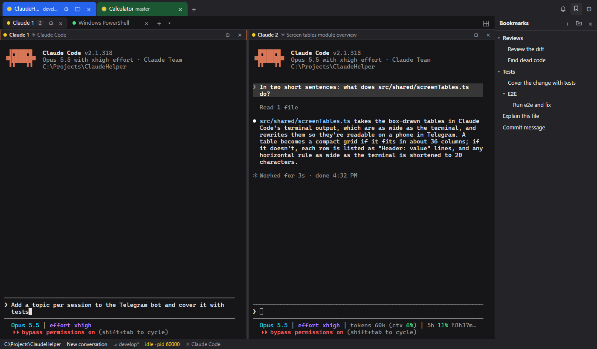
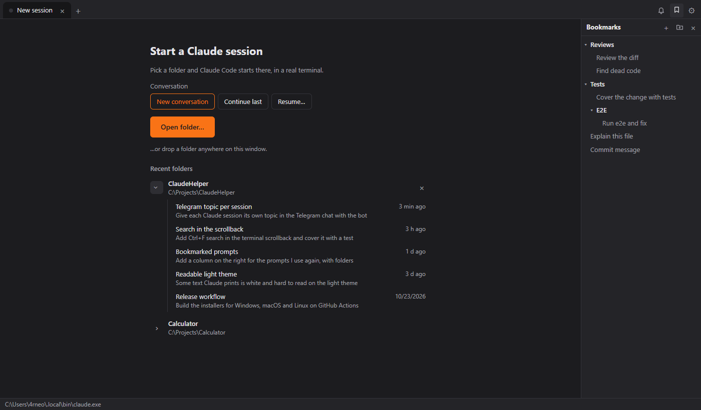
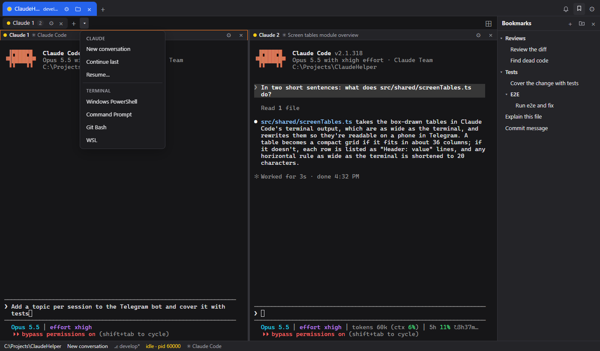
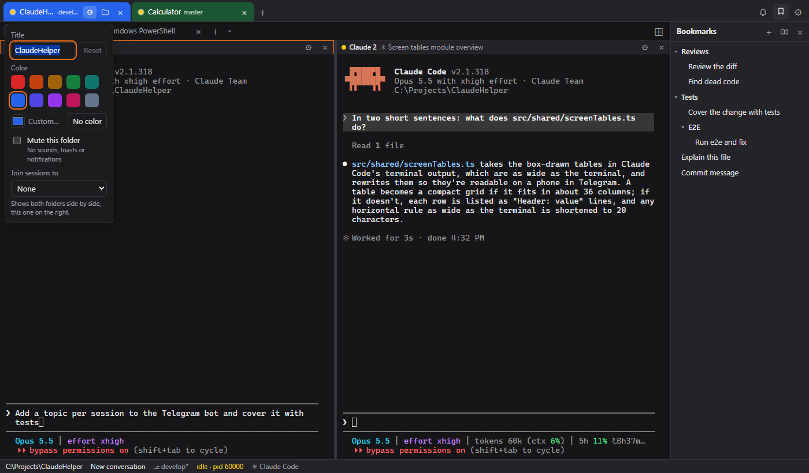
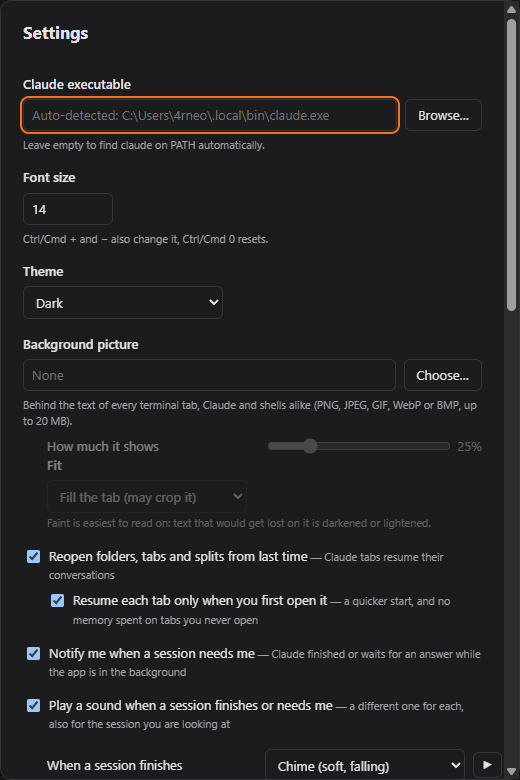
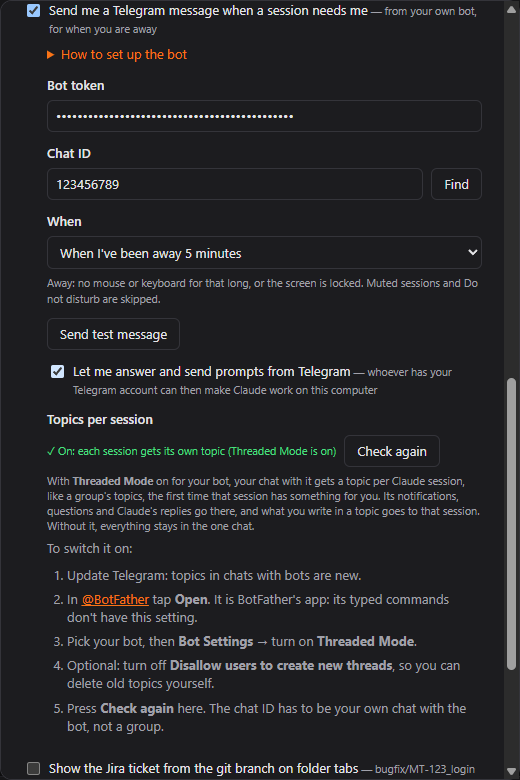
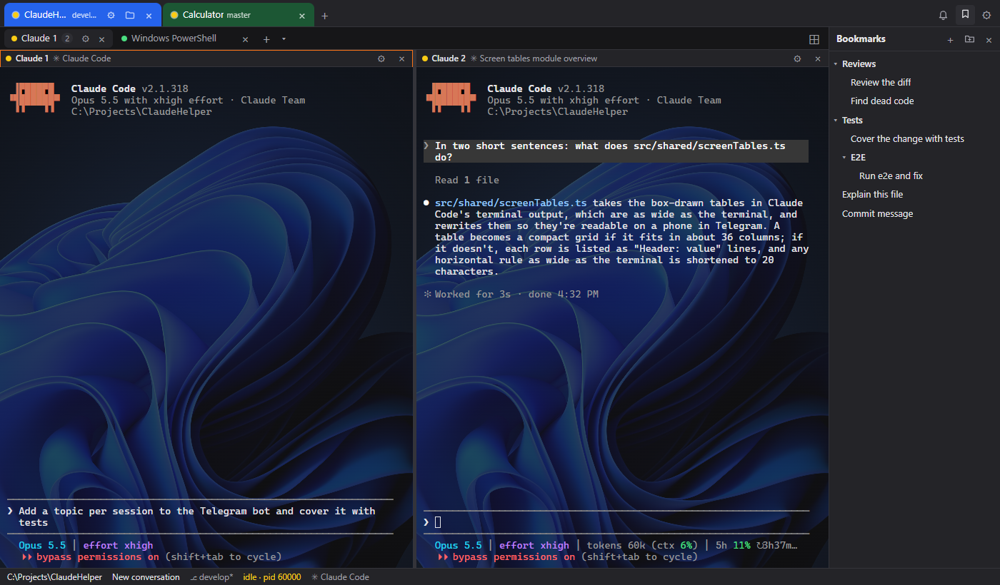

# ClaudeHelper

A desktop app for **Windows, macOS and Linux** that runs the real **Claude Code CLI** in tabs and split panes. Pick a folder and a Claude session starts there. Close the app, and next time everything comes back: folders, tabs, splits with their sizes, the window, and each tab's conversation.

It tells you when a session is done or needs your answer: with a sound, on its tab, on the taskbar, and, if you like, on your phone through your own Telegram bot, where you can answer Claude, send it prompts and read its replies.

**[Download the latest release](https://github.com/4rneorist/ClaudeHelper/releases/latest).** It has installers for Windows (`.exe`), macOS (`.dmg`, Apple Silicon) and Linux (`.AppImage` and `.deb`). You also need the Claude Code CLI, see [Install](#install).

### What's new in 1.2.0

- **Notes for each session.** A notepad button opens a column on the right of a session for your own notes. Each session has its own, they save as you type, and they come back after a restart. Drag the column's edge to make it wider.
- **Claude Code's setup in one window.** The puzzle button shows your skills, commands, agents, output styles, memory, MCP servers, plugins, marketplaces, hooks, permissions, settings and keybindings, your own or a folder's, and lets you change them.
- **Hotkeys for bookmarked prompts.** Give a prompt a key like Ctrl+Shift+C and pressing it puts the prompt into the session, unsent.

### What's new in 1.1.0

- **Claude on your phone.** Your own Telegram bot (optional) says when a session finishes or needs you, headed `✅ IDLE`, `🔔 NEED YOUR ATTENTION` or `⏰ STILL NEEDS YOUR ATTENTION`. With remote control on, you can answer Claude's questions with a tap (or with numbers and your own words where it takes several answers), send prompts, read what a chat shows, and open new chats. Claude's whole reply comes back when it is done, formatted for a phone, tables included. With Threaded Mode on for the bot, each session gets its own topic.
- **Bookmarked prompts.** Keep the prompts you use again in folders and subfolders, in a column on the right. One click puts a prompt into the session; the right-click menu bookmarks selected text and pastes bookmarks.
- **Search and jump.** Ctrl+F searches the scrollback; Ctrl+↑ and Ctrl+↓ jump between your messages to Claude.
- **Open files from the output**, like in VS Code: Ctrl+click a path that Claude or a shell printed.
- **Send text to another session** from the right-click menu, and **snip the screen into the prompt** with Ctrl+Shift+S.
- **Jira ticket from the branch** on the folder tab (optional), one click away.
- **A picture behind the terminals**, as in Windows Terminal, with how much it shows and how it fits. Text that would get lost on it, or on the light theme, is darkened or lightened until it reads.

### What's new in 1.0.1

- **See what each Claude is doing.** The status dot is green and pulsing while Claude works, yellow when it's done and waits for your next prompt, and red and pulsing when it needs your answer (a permission prompt, a question, a plan to approve). A folder tab is red if any Claude in it needs you, green if any is still working, and yellow only when all are idle.
- **Never miss a session that needs you.** A sound for "finished" and another for "needs your answer", every time. For a session you aren't looking at, its tab is underlined, a toast says where it's from, and the bell at the top right keeps the list. With the window in the background or minimized, the taskbar button turns red or yellow and Windows shows a notification.
- **Get there fast.** Ctrl+Shift+J jumps to the next session that waits, the status bar counts them ("● 1 needs your answer · ● 2 finished"), and hovering a tab previews its last lines.
- **Less noise when you want it.** Mute a session or a folder, switch on Do not disturb, choose the sounds and their volume, and set how often a question that is still waiting reminds you.
- **Name and color your tabs.** ⚙ on a folder or session tab sets its title and color; drag tabs to reorder them.
- **Two folders side by side.** "Join sessions to" in a folder's settings shows two folders next to each other, each with its own tabs.
- **Git branch on each folder tab**, with `*` when there are uncommitted changes.

Details for each are under [Features](#features).



## Why ClaudeHelper

- **The real Claude Code, not a lookalike.** Every tab runs the `claude` CLI you already use, on the operating system's own terminal engine. Slash commands, permission prompts, Shift+Tab modes, Esc to interrupt, colors and resizing work as they do in Windows Terminal, iTerm2 or GNOME Terminal.
- **Windows, macOS and Linux.** One app with the same features on all three. It finds the shells each system has.
- **Remembers your workspace.** It saves the open folders, terminal tabs, split layouts **with their sizes**, the active tab and pane, and the window size and position. It saves as you go, so even a crash loses nothing. On the next start each Claude tab resumes its own conversation.
- **Many sessions side by side.** One tab per folder and several terminals in each, split right or down, or a 2×2 grid. Drag a tab onto the edge of a pane to dock it there. Join two folders to see them next to each other.
- **Find a folder or session at a glance.** Give folder and terminal tabs their own title and color. One click on the tab's folder icon opens it in File Explorer, Finder or your file manager.
- **Knows when Claude needs you.** Each tab shows whether Claude works, is done or waits for your answer, with a sound for each. Sessions you aren't looking at get a toast, an entry under the bell and a red or yellow taskbar button, and Ctrl+Shift+J takes you there.
- **Old conversations a click away.** The start screen lists the last conversations in each recent folder; click one to resume it.
- **A shell next to Claude.** PowerShell, Command Prompt, Git Bash and WSL on Windows; your login shell, bash, zsh and fish on macOS and Linux.
- **Answer from anywhere.** With your own Telegram bot, Claude's questions, calls and replies reach your phone, and you can answer and send prompts from there. Only your own chat with the bot is obeyed.
- **Prompts you use again, at hand.** Bookmarked prompts in folders, each on a hotkey if you like, a search over the scrollback, and file paths you can click open.
- **Notes next to each session.** A column on the right of a session for what you want to remember about it: what to check, what to ask next. Each session keeps its own, across restarts.
- **Claude Code's setup without hunting for files.** Skills, agents, hooks, MCP servers, plugins, memory, permissions and keybindings, yours or a folder's, in one window where you can read and change them.

## Screenshots

**Start screen.** Recent folders, each with its last conversations; the bookmarks column on the right.



**New terminal menu (▾).** A new, continued or resumed Claude conversation, or any shell installed on the machine.



**Folder settings (⚙).** Title, color, muting, and joining another folder to see both side by side.



**Settings.** Which `claude` to run, font size, theme, a background picture, restoring on start, notifications and sounds.



**Telegram.** Your own bot, remote control, and a topic per session.



**A picture behind the terminals.**



## Install

ClaudeHelper runs the Claude Code CLI but doesn't include it. Install it and log in once before you start the app:

- **Windows (PowerShell):** `irm https://claude.ai/install.ps1 | iex`
- **macOS and Linux:** `curl -fsSL https://claude.ai/install.sh | bash`

Then run `claude` once in a terminal to log in. The app finds `claude` by itself. If yours lives somewhere unusual, set its path in **Settings**.

## Features

- **Folders as tabs:** each top-level tab is a folder.
  - Its folder icon opens the folder in File Explorer (Windows), Finder (macOS) or the file manager (Linux).
  - **⚙** (or a right-click on the tab) opens the folder's settings:
    - **Title:** shown instead of the folder name. **Reset** goes back to the name.
    - **Color:** one of ten presets, any custom color, or none. The open tab shows the full color, the others a softer one, and the title switches between black and white to stay readable.
    - **Join sessions to:** shows this folder next to another one, see **Folders side by side** below.
    - Changes apply as you make them; Esc undoes them. Title and color belong to the folder, so they come back whenever that folder is opened, and the start screen shows the title too.
  - ⚙ and the folder icon show on the open tab and on the one under the mouse.
  - Drag a folder tab to change the order.
- **Several terminals per folder:** they show as sub-tabs.
  - **+** opens a new Claude session.
  - **▾** offers New / Continue / Resume…, plus the shells installed on the machine:
    - **Windows:** PowerShell 7, Windows PowerShell, Command Prompt, Git Bash, WSL.
    - **macOS and Linux:** your login shell, bash, zsh, fish.
  - **⚙** on a sub-tab (or a right-click on it) sets its title, instead of Claude 1, Claude 2…, and its color. In a split, each pane's title bar has its own ⚙; the sub-tab shows its first pane's title and color. Both are saved with the layout.
  - Drag a sub-tab to change the order.
- **Split panes:**
  - **⊞** splits the current terminal right or down, or fills a 2×2 grid with Claude sessions.
  - Drag a divider to resize; double-click it to make both sides equal.
- **Drag to dock** (within a folder):
  - Drag a sub-tab onto the left, right, top or bottom edge of a pane to split with it.
  - Drag a pane's title bar onto the sub-tab row to make it its own tab again.
  - Hovering a dragged item over a sub-tab for half a second switches to it, so you can drop it into that tab's panes.
  - A terminal keeps running when it moves.
- **Folders side by side:**
  - In a folder's settings, pick another open folder under **Join sessions to**. The two show next to each other, that folder on the left and this one on the right, each with its own sub-tabs. Their tabs sit together, linked by ⇆, and move together when dragged.
  - Drag the divider between them to resize; double-click it to make both halves equal.
  - Clicking into either half makes that folder the active one, so shortcuts and the status bar follow it.
  - **None** shows them one at a time again, and closing either folder ends the pair. The pair and the divider position are saved with the layout.
- **Knows what Claude is doing:**
  - Claude Code puts a spinner in its window title while it works and ✳ when it stops; the app reads that, and when Claude stops it looks at the screen for a choice Claude waits for (a permission prompt, a question, a plan to approve).
  - The status dot on the pane, its tab and its folder tab shows it: **green and pulsing** while Claude works, **yellow** when it's idle and waits for your next prompt, **red and pulsing** when it needs your answer. A folder tab is red if any Claude in it needs your answer, green if any is still working, and yellow only when all of them are idle. The status bar says "working", "idle" or "needs your answer".
  - Every time Claude finishes or asks, a sound plays, also for the session you are looking at: by default a soft falling chime when it finishes, a brighter rising one when it needs your answer. Settings lets you pick one of five sounds for each (▶ plays it) and the volume, or turn sounds off.
  - When Claude finishes or asks in a tab you aren't looking at (another tab, or the app in the background):
    - That tab and its folder tab get a yellow or red underline until you look at it.
    - A toast in the bottom right says where it's from ("my project › Claude 2") and what happened ("Claude needs your answer: Fix the login bug"); click it to go there.
    - The bell at the right of the top bar counts what you haven't seen (red if something asks) and lists everything from this run with its time; click an entry to go to that session. Looking at a session marks its entries read.
    - A terminal bell from Claude counts as asking.
  - If the app is in the background, its taskbar button flashes and an OS notification, with the app's icon, says the same; clicking it brings that tab up. Settings has switches for the OS notifications and for the sounds.
  - **What waits:** a session that asks for your answer, and one that finished while you were elsewhere and you haven't looked at yet.
    - The taskbar button shows it even with the window minimized (Windows): red while a session asks, yellow while one finished unseen, a moving green bar while any works, plus a red or yellow dot on the icon. On macOS the dock icon counts the sessions waiting.
    - The status bar shows "● 1 needs your answer · ● 2 finished" on the right; click a part to go to the next session of that kind.
    - **Ctrl+Shift+J** (Cmd+Shift+J on macOS) goes to the next waiting session, those that ask first.
  - **Reminder:** while a session keeps asking and you haven't looked, it calls again every 5 minutes (at most 3 times; Settings sets the interval or turns it off).
  - **Mute** a session or a whole folder in its ⚙ settings, for long jobs you don't need to hear about: it keeps its dot, underline and bell entry, but plays no sound, shows no toast or OS notification, and doesn't count as waiting. Muted tabs show a crossed-out bell.
  - **Do not disturb**, a switch at the top of the bell list: no sounds, toasts or OS notifications, while the list still fills. It switches off when the app restarts.
  - **Telegram** (off by default): a message from your own bot when a session finishes or needs your answer, reminders included. Muted sessions and Do not disturb are skipped. In Settings, **When** picks between "every time" (even with the app in front of you), "whenever the app is in the background" and "when I've been away N minutes". Away means no mouse or keyboard input for that long, or a locked screen, and then you also hear about the session you had in front of you. To set it up:
    1. In Telegram, open [@BotFather](https://t.me/BotFather), send `/newbot`, and pick a name and a username that ends in `bot`. BotFather replies with the bot token (`123456789:AAE…`). Paste it into **Settings → Bot token**.
    2. Open your new bot from BotFather's reply (`t.me/your_bot`) and press **Start**. A bot can't write to you before that.
    3. Press **Find** next to Chat ID: the app reads the chat that last wrote to the bot. By hand instead: open `https://api.telegram.org/bot<token>/getUpdates` in a browser and copy the number after `"chat":{"id":`. For a group, add the bot to it and send `/start@your_bot` there; a group's ID starts with `-`.
    4. Press **Send test message**, then Save.

    No server, webhook or payment is involved. The app talks to `api.telegram.org` directly, through the system proxy if there is one. A message starts with what happened (`✅ IDLE`, `🔔 NEED YOUR ATTENTION`, or `⏰ STILL NEEDS YOUR ATTENTION` for a reminder), then which folder and tab, and the conversation's name below. Without remote control, it never contains what is in the terminal. The token is stored encrypted for your OS user (Windows DPAPI, macOS Keychain, Linux libsecret) when the system offers that.
  - **Telegram remote control** (off by default; Settings → **Let me answer and send prompts from Telegram**). It only works in your own private chat with the bot: the chat ID must be yours (a number without `-`). Messages from anyone else, from groups, and anything sent while the app was closed are ignored. Whoever has your Telegram account can then make Claude work on your computer, so keep that in mind before you switch it on.
    - **Reply** to any bot message about a chat (swipe it in Telegram) to send that chat a prompt. It is typed in and sent with Enter; a prompt sent while Claude works waits in Claude's queue.
    - **Claude's whole reply** comes back once it is done with a prompt or answer sent from Telegram: the `✅ IDLE` message carries everything Claude wrote in that turn, formatted (code, bold, lists, tables), read from the conversation's transcript rather than the screen. A long reply takes several messages (five at most; beyond that its start is left out). Its questions in the meantime come to Telegram too, even when the chat is muted.
    - **Questions** come with what Claude's dialog shows (the command or file it wants to touch, or its question) and a button per option. Tap one, or reply with its number. Where Claude offers "Type something", reply in your own words. For a question that takes several answers, reply with their numbers (`1 3`), and your own words for its "Type something" after a colon (`1 3: Black`). The next question of a form follows by itself, and the form is submitted at the end. A button for a question that has been answered or has changed says so.
    - **A topic per session** (optional): in @BotFather tap **Open**, pick your bot, then **Bot Settings** → turn on **Threaded Mode**. Each session then gets its own topic in your chat with the bot ("my project › Claude 1", one colour per folder) the first time it has something for you, and its calls, questions and replies go there. Write in a topic and it goes to that session; there `/getchat` and `/prompt` need no chat name. Answers to what you write come where you wrote it. A tab keeps its topic across restarts, its topic is renamed with it, and closing it leaves a last word there. To delete old topics yourself, also turn off "Disallow users to create new threads" in @BotFather. Send test message in Settings says whether topics are on. Without Threaded Mode, or if Telegram can't write to a topic, everything goes to the one chat as before.
    - **Commands** (they appear in Telegram's `/` menu):
      - `/chats` lists the open Claude chats, numbered, with their state.
      - `/newchat [name]` opens a new chat in one of the open folders, in the background. It asks which folder when more than one is open, and asks for a name if you gave none.
      - `/prompt <chat> <text>` sends a prompt, or answers the chat's question. `<chat>` is a number from `/chats`, a name or the start of one, or `folder/name` when names repeat.
      - `/getchat <chat> [rows]` shows the chat's last 50 rows (up to 100), without Claude's input box, with a 🔄 Refresh button.

      Claude draws tables as wide as its terminal, which a phone can't show, so in Telegram a table that fits a phone stays a grid and a wider one becomes its rows, one field a line (`Repo: Tenant`).
      - `/help` lists all this.

      With remote control on, Claude's questions and the screens you ask for go to Telegram.
  - **Preview:** hold the mouse over a session tab to see what it's doing and its last lines (its question, when it asks).
- **Git branch:** each folder tab shows the folder's branch (the short commit when detached), with `*` for uncommitted changes, and so does the status bar. It is refreshed every 5 seconds and when the window gets focus, without taking git's index lock, so it never gets in the way of Claude's commits.
- **Jira ticket from the branch** (off by default): switch it on in Settings and give the ticket URL, e.g. `https://your-company.atlassian.net/browse/{key}`. A branch like `bugfix/MT-25443_login` then shows **MT-25443** on its folder tab and in the status bar; a click opens the ticket in your browser.
- **Bookmarked prompts:** the bookmark button next to ⚙ shows or hides a column on the right with your saved prompts. It stays open or closed across restarts.
  - **+** adds a prompt, and the folder button adds a folder, at the top level. Hold the mouse over a folder to add a prompt or a subfolder in it, or to edit (✎) or delete it; prompts have ✎ and delete too. The editor sets the title, the text and the folder, so it also moves things between folders. Without a title, a prompt is named after its first line. Folders nest up to 8 levels deep.
  - Click a prompt to put it into the active session's prompt, unsent, so you can add to it or press Enter. Click a folder to fold or unfold it.
  - **Hotkey:** in the editor, click the Hotkey field and press the keys, like Ctrl+Shift+C. Pressing them in a terminal, or anywhere outside a text field, then puts the prompt into the active session, unsent. A hotkey needs Ctrl, Alt or Cmd, or is an F-key; Ctrl+C, Ctrl+V and Ctrl+D stay Claude's. The editor says when a key would take over one of the app's shortcuts or a Claude Code key. Hotkeys match the physical keys, so they work with any keyboard layout.
  - Right-click in a terminal: **Paste from Bookmarks** lists your folders and prompts as submenus. **Add Selection to Bookmarks…** opens the editor with the selected text. Without a selection it offers **Add Copied Text to Bookmarks…**, because Claude in fullscreen copies what you drag over.
  - They are saved in `bookmarks.json` in the app's data folder. If that file is ever unreadable, a copy is kept next to it before it is replaced.
- **Session notes:** the notepad button on the right of the sub-tab row shows or hides a notes column on the right of the session you are in. In a split, each pane's title bar has its own notepad button and each pane its own notes.
  - Notes save as you type, with the layout, and come back after a restart; so does whether a session's notes are open. They belong to the tab, so `/clear` or `/resume` inside Claude keeps them.
  - Esc in the notes takes you back to the terminal; × closes the column. A sub-tab with notes shows a small notepad.
  - Drag the column's left edge to resize it; double-click the edge for the default width. All sessions share that width.
  - Closing a session that has notes asks first, since its notes go with it.
- **Claude Code's setup:** the puzzle button next to the bookmark button opens a window with what Claude Code reads and runs, for your user or for one of the open folders: skills, commands, agents, output styles and memory (CLAUDE.md files and rules); MCP servers, plugins and marketplaces; hooks, permissions, settings and keybindings; and the claude.ai account it is logged in with. Each section lists what is set and in which file, and lets you add, change or remove it; the window asks before throwing away unsaved changes.
- **Search the scrollback:** **Ctrl+F** (Cmd+F on macOS) opens a search bar over the terminal. Matches are highlighted as you type, with a count; Enter and Shift+Enter go to the next and previous one, Esc closes it.
- **Jump between your messages:** **Ctrl+↑ / Ctrl+↓** (Cmd+↑ / Cmd+↓ on macOS) in a Claude tab scrolls to your previous or next message to Claude, and flashes it.
- **Claude's fullscreen renderer:** with `/tui fullscreen`, Claude draws its own screen and the conversation isn't in the terminal's scrollback. Search and the message jumps then first open Claude's transcript view (Ctrl+O) and have it write the whole conversation into the scrollback (`[`). Esc or `q` takes Claude back to its normal view.
- **Open files from the output, like in VS Code:** **Ctrl+click** (Cmd+click on macOS) a file or folder path that Claude or a shell printed, such as `C:\Users\me\out\head.png`, `src/store.ts:877` or `~/notes.md`, and it opens with its default program; a folder opens in File Explorer, Finder or your file manager. Paths are underlined while the mouse is on them, if the file exists, with the hint "Open file (Ctrl + click)". Relative paths count from the folder the terminal started in. Programs and scripts (`.exe`, `.bat`, `.ps1`, `.js`, executable files on macOS and Linux) are only shown in their folder, since opening them would run them.
- **Send to another session:** select text in any terminal, right-click and pick **Send Selection To › Claude 2 · my project**. The text lands in that Claude's prompt without being sent, so you can add "review this:" and press Enter. A tab that hasn't started yet starts and gets it once Claude is ready. In Claude's fullscreen renderer a drag selects inside Claude, which copies it; the menu then offers **Send Copied Text To**.
- **Snip the screen into the prompt:** **Ctrl+Shift+S** (Cmd+Shift+S on macOS) in a Claude tab, or **Snip Screen into This Prompt** in its right-click menu. The app steps aside, the system's own picker lets you drag a region (the Snipping Tool overlay on Windows, `screencapture` on macOS, gnome-screenshot, Spectacle or Flameshot on Linux), and the picture arrives in Claude's prompt as an image. A cancelled snip leaves the clipboard as it was.
- **Picks up where you left off:**
  - The app saves the open folder tabs, terminal tabs, split layouts with their sizes, the active tab and pane, and the window size and position. Saving happens as you go: within a fraction of a second of opening a folder or tab, starting or resuming a session, closing, docking or resizing. A crash loses nothing. Everything reopens on the next start.
  - Each Claude tab resumes its own conversation, even after `/clear` or `/resume` inside claude switched it to another one. The app reads which conversation each running claude has open from Claude Code's session registry (`~/.claude/sessions/`), and watches it for changes.
  - Shell tabs reopen as fresh shells in the same folder.
  - **Restart** on an exited Claude tab also resumes its conversation.
  - Only the tabs you see start right away. The others wait, with a hollow dot, and resume when you first open them: the app starts quicker, and tabs you don't get back to take no memory. Settings switches this off ("Resume each tab only when you first open it").
  - Turn restoring off in Settings ("Reopen folders, tabs and splits from last time").
- **Recent sessions:**
  - Expand a recent folder (›) to see its last 5 Claude conversations, read from `~/.claude/projects` (or `$CLAUDE_CONFIG_DIR`).
  - Click one to resume it with `claude --resume <id>`.
  - If the folder is already open, the session opens as a sub-tab there.

The sessions run in a real terminal:
- **Renderer:** [xterm.js](https://xtermjs.org/) draws the terminal.
- **Engine:** [node-pty](https://github.com/microsoft/node-pty) runs `claude` on the OS's own terminal engine:
  - **Windows:** ConPTY, the console engine built into Windows 10/11. Settings has an experimental option for the newer `conpty.dll`/`OpenConsole.exe` engine from Windows Terminal that ships with node-pty. It is off by default because it occasionally crashed the app on exit in testing.
  - **macOS and Linux:** the standard Unix pseudo-terminal.

## Develop

You need:
- Node.js 22+ and npm. Only for building; the installed app doesn't need them.
- The Claude Code CLI, as in [Install](#install).
- Linux only: node-pty compiles at `npm install`, so you also need `python3`, `make` and `g++` (e.g. `sudo apt install build-essential python3`).

```bash
npm install
npm run dev          # app with hot reload
npm test             # unit tests (Vitest)
npm run test:e2e     # builds, then drives the real app with Playwright against a fake claude
npm run typecheck
npm run lint
```

## Build installers

```bash
npm run build:win           # installers/claude-helper-<version>-setup.exe (NSIS)
npm run build:mac           # installers/claude-helper-<version>.dmg
npm run build:linux         # installers/claude-helper-<version>.AppImage and a .deb
npm run build:linux:docker  # the Linux installers from Windows or macOS, built in Docker
npm run build:unpack        # unpacked app in installers/<platform>-unpacked, handy for testing
```

Everything lands in `installers/`, which git ignores.

node-pty is a native module, so each installer is built on its own system: the Windows one on Windows, the macOS one on a Mac. The Linux ones can also come from Windows or macOS: `build:linux:docker` copies the sources into a `node:22-bookworm` container, compiles node-pty there and copies the installers back. It needs Docker running.

To run the end-to-end tests against a packaged build:
`CLAUDE_HELPER_EXE=installers/win-unpacked/claude-helper.exe npx playwright test`.

To try a change in the running app next to your installed ClaudeHelper, give the dev app its own profile. Otherwise both share one, and the dev app reopens and resumes your open sessions a second time: `CLAUDE_HELPER_USER_DATA=<some empty folder> npm run dev`.

### Releases

Pushing a version tag builds all three installers on GitHub Actions (`.github/workflows/release.yml`) and attaches them to a draft release:

```bash
npm version 1.0.2            # sets the version in package.json, commits and tags v1.0.2
git push origin master v1.0.2
```

The tag has to match the version in `package.json`. Review the draft under **Releases** on GitHub and publish it. **Actions → Release → Run workflow** builds the installers without a release.

## Keyboard

| Action | Windows / Linux | macOS |
|---|---|---|
| Copy selection | Ctrl+C (only when text is selected), Ctrl+Shift+C, Ctrl+Insert | Cmd+C |
| Paste | Ctrl+V, Ctrl+Shift+V, Shift+Insert | Cmd+V |
| Paste image into the prompt | Ctrl+V (Linux) or Ctrl+V/Alt+V (Windows) with an image on the clipboard; claude reads it itself | Ctrl+V |
| Newline in the prompt | Shift+Enter (sent as Ctrl+J) | Shift+Enter |
| New Claude terminal in this folder | Ctrl+Shift+T | Cmd+T |
| New folder tab | Ctrl+Shift+N | Cmd+N |
| Close the focused terminal | Ctrl+Shift+W | Cmd+W |
| Next / previous terminal tab | Ctrl+Tab / Ctrl+Shift+Tab | same |
| Next / previous folder tab | Ctrl+PageDown / Ctrl+PageUp | same |
| Go to the next session that asks or finished unseen | Ctrl+Shift+J | Cmd+Shift+J |
| Search the scrollback | Ctrl+F, Ctrl+Shift+F | Cmd+F |
| Previous / next of your messages to Claude | Ctrl+↑ / Ctrl+↓ | Cmd+↑ / Cmd+↓ |
| Snip a region of the screen into Claude's prompt | Ctrl+Shift+S | Cmd+Shift+S |
| Put a bookmarked prompt into the session | its hotkey, set in the bookmark editor | same |
| From a session's notes back to its terminal | Esc | same |
| Font size bigger / smaller / reset | Ctrl+= / Ctrl+- / Ctrl+0, or Ctrl + mouse wheel | Cmd+= / Cmd+- / Cmd+0, or Cmd + wheel |

All other keys go straight to claude, including Ctrl+C with nothing selected, Esc, Shift+Tab, Ctrl+R, Ctrl+S, Ctrl+T and Ctrl+Shift+- (undo). In a shell, Ctrl+↑ / Ctrl+↓ go to the shell too.

The shortcuts work with any keyboard layout: with a Ukrainian or Russian layout active, Ctrl+C still copies the selection, and Ctrl+V and the Ctrl+Shift shortcuts still work.

Other mouse actions:
- **Right-click in a terminal:** opens a menu with Copy and Paste, **Paste from Bookmarks**, **Add Selection to Bookmarks…**, **Send Selection To** another Claude session, and, in a Claude tab, **Snip Screen into This Prompt**. On a folder tab, sub-tab or pane title bar it opens that tab's settings, like ⚙.
- **Ctrl+click on a link** (Cmd+click on macOS): a web link opens in your browser, which matters for the `/login` flow, and a file path opens with its default program. A plain click leaves links alone, as in VS Code.
- **Dropping a file on a running session:** inserts its path.
- **Dropping a folder on the start screen:** opens a session there.

## How it is put together

```
Renderer (React + xterm.js)  ──window.api (preload, contextBridge)──▶  Main process
  TabBar (folders) → WorkspaceView (sub-tabs)                          ipc.ts (validates every call)
    → LayoutView (split tree of panes) → TerminalView                  sessionManager.ts (node-pty, output batching)
      + NotesBar (each pane's own notes)
  terminal/TerminalSession.ts (one xterm per terminal,                 claudeResolver.ts (find claude, build env)
    survives being moved between panes and tabs)                       shells.ts (detect installed shells)
  terminal/claudeActivity.ts (working / idle / asking,                 claudeSessions.ts (past sessions per folder)
    from Claude's title and screen)                                    uiState.ts / windowState.ts (restore on start)
  attention.ts + waiting.ts + sounds.ts (sounds, toasts, bell list,    settingsStore.ts (JSON in userData)
    what waits, reminders) → Notifications, StatusBar                  attention.ts (OS notifications) / taskbar.ts
  gitPolling.ts (branch per folder)                                    gitInfo.ts (branch, uncommitted changes)
  BookmarksPanel (prompts, hotkeys)                                    bookmarksStore.ts (bookmarks.json)
  claudeConfig/ClaudeConfigDialog (the "Claude Code" window)           claudeConfig*.ts, claudeMcp.ts, claudeMemory.ts,
                                                                         claudePlugins.ts, claudeSettings.ts (~/.claude, .claude)
```

The store (`src/renderer/src/store.ts`) has three levels:
1. **Workspaces:** folders. Two can be joined (`joinedTo`) to show side by side.
2. **Sub-tabs:** each sub-tab holds a split layout.
3. **Terminals:** the layout's leaves. Terminals are stored flat by key, so moving one between layouts never restarts its process. A terminal also carries its notes and whether its notes bar is open; both are saved with the layout.

The split and dock rules are pure functions in `layout.ts`.

| Path | Contents |
|---|---|
| `src/shared/ipc.ts` | The one contract (channels and types) between main, preload and renderer; `questions.ts` words Claude's questions for Telegram; `screenTables.ts` makes Claude's tables fit a phone; `uiState.ts` is the saved layout (with each session's notes); `hotkeys.ts` names and checks bookmark hotkeys; `claudeConfig.ts` and `frontmatter.ts` describe what the "Claude Code" window manages and read and write skills' and agents' frontmatter |
| `src/main/` | Electron main process: window hardening, IPC handlers, PTY sessions, shells, past sessions, settings, bookmarks (`bookmarksStore.ts`), Telegram (`telegram.ts`; remote control in `telegramBot.ts`; Claude's replies formatted in `telegramMarkdown.ts`; a topic per session in `telegramTopics.ts`), OS notifications and the taskbar button, git branch, screen snips (`snip.ts`). The "Claude Code" window's files: skills, commands, agents, output styles and hooks (`claudeConfig.ts`), memory (`claudeMemory.ts`), settings and keybindings (`claudeSettings.ts`), MCP servers (`claudeMcp.ts`, through `claude mcp`), plugins and marketplaces (`claudePlugins.ts`, through `claude plugin`), what comes from your account and plugins (`claudeExtras.ts`), and the checks on every request from it (`claudeConfigChecks.ts`) |
| `src/preload/` | The minimal, typed `window.api` bridge |
| `src/renderer/src/` | React UI. Pure, tested functions: `layout.ts` (split/dock tree), `tabColors.ts` (tab colors and readable titles), `terminal/keybindings.ts`, `terminal/claudeActivity.ts` (what Claude is doing, from its title and screen; where your messages are), `jira.ts` (the ticket key in a branch name), `bookmarks.ts` (the bookmark tree: add, edit, move, remove), `waiting.ts` (which sessions wait, in what order, reminders) and `telegramChats.ts` (the chats Telegram lists and finds by name, the answers you send, topic names). `telegramCommands.ts` carries out what you send the bot; `telegramTopics.ts` keeps each tab's topic, its name and colour. `hotkeyNotes.ts` says which app or Claude Code keys a bookmark's hotkey takes over; `keybindingCatalog.ts` lists Claude Code's keybinding actions for the keybindings editor; `components/NotesBar.tsx` is a session's notes column; `components/claudeConfig/` is the "Claude Code" window |
| `tests/unit/` | Vitest tests for path resolution, session management, past-session parsing, shell detection, layouts, settings, tabs, joined folders, Claude's activity, what waits, notifications, git info, tab colors, validation, keybindings, bookmarks and their hotkeys, session notes (saved, checked and restored), and the "Claude Code" window (items, frontmatter, MCP, memory, plugins, settings) |
| `tests/e2e/` | Playwright tests that drive the built app. A fake `claude` reports how it was launched, echoes input, and can work, finish and ask like the real one |
| `scripts/` | `build-linux-docker.mjs`, which builds the Linux installers in Docker |
| `docs/screenshots/` | The screenshots in this README |

### Security

- **Renderer sandbox:** the renderer runs sandboxed with context isolation and no Node access. It has a strict CSP and cannot navigate away.
- **Main process checks:** the main process validates every IPC argument (session ids, terminal sizes, folders, URLs) and only accepts calls from its own window.
- **The "Claude Code" window:** the renderer never names a file to read or write. Main works out every path itself from a scope (yours or a folder's), a project folder that is open, and a plain item name, and rebuilds each request from the fields it knows.
- **Links:** only `http(s)` links open externally. A file path opens only if it exists, and a program or script is shown in its folder instead of being run.
- **Telegram remote control:** off by default. When on, main obeys only messages and button presses from the configured private chat, and drops anything written before the app started. Buttons work only on messages sent in the current run, and an answer is typed only while that same question is on screen. Commands can't run shell tabs; they only reach Claude chats.

### Environment passed to claude

The app passes on your full environment with these changes:
- **Terminal variables:** it sets `TERM=xterm-256color`, `COLORTERM=truecolor` and `TERM_PROGRAM=ClaudeHelper`.
- **Session markers:** it removes the variables a running Claude Code session injects into its children (`CLAUDECODE`, `CLAUDE_CODE_CHILD_SESSION`, …). If you start the app from inside a Claude session, the new sessions are still real top-level sessions.
- **macOS/Linux PATH:** the login shell's environment is loaded once at startup, so a `claude` installed through your shell profile is found even when the app starts from the Dock or a launcher.

## Roadmap

| Phase | Planned work |
|---|---|
| **2** | Per-launch `--model` and `--permission-mode`. Pinned folders. Claude's own status protocol (OSC 7501) on macOS and Linux, to tell a permission prompt from a finished turn (on Windows, ConPTY doesn't pass the terminal's reply back to claude) |
| **3** | An optional Docker sandbox per session. File tree and git diff panels. A browser for past conversations. Auto-update and code signing. A phone push (ntfy, Slack or Teams) when a session asks while you are away |

## License

[MIT](LICENSE) © 2026 Vasyl Kravinskyi
