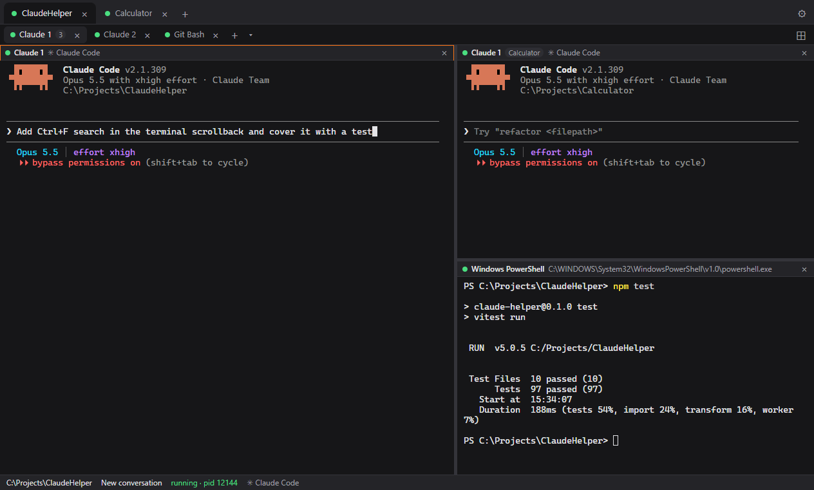
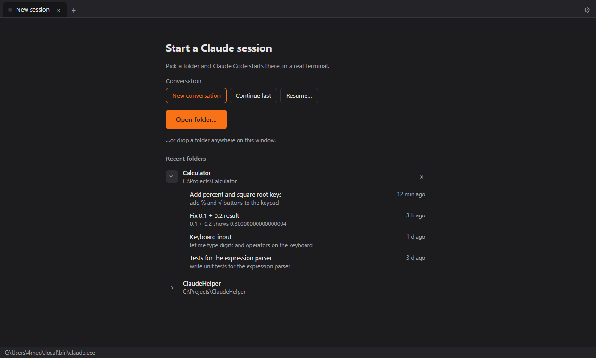
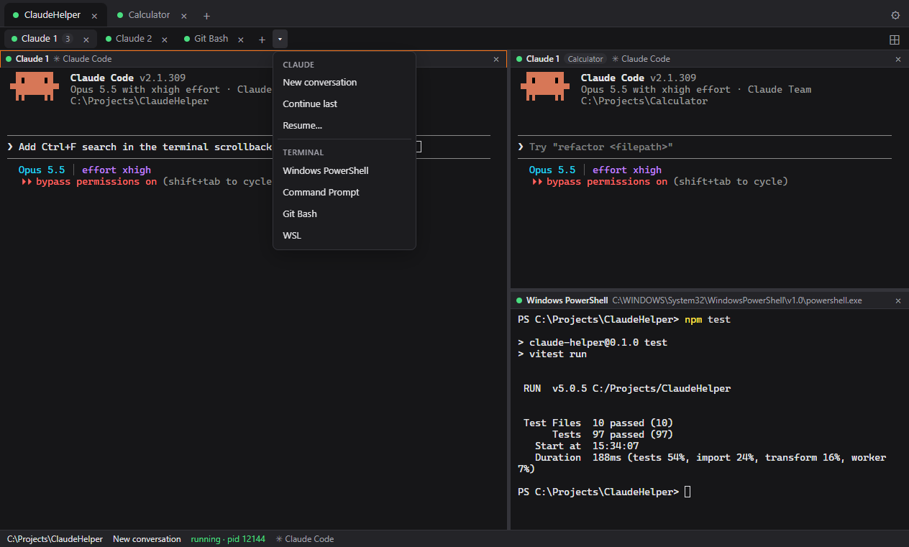
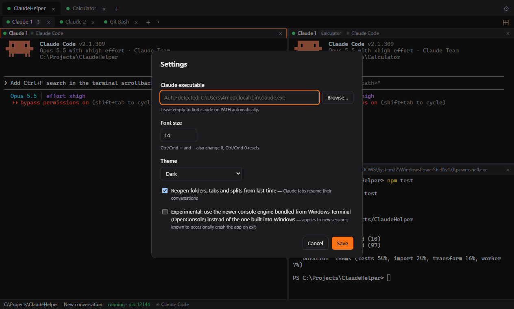

# ClaudeHelper

A desktop app for **Windows, macOS and Linux** that runs the real **Claude Code CLI** in tabs and split panes. Pick a folder and a Claude session starts there. Close the app, and next time everything comes back: folders, tabs, splits with their sizes, the window, and each tab's conversation.



## Why ClaudeHelper

- **The real Claude Code, not a lookalike.** Every tab runs the `claude` CLI you already use, on the operating system's own terminal engine. Slash commands, permission prompts, Shift+Tab modes, Esc to interrupt, colors and resizing work as they do in Windows Terminal, iTerm2 or GNOME Terminal.
- **Windows, macOS and Linux.** One app with the same features on all three. It finds the shells each system has.
- **Remembers your workspace.** It saves the open folders, terminal tabs, split layouts **with their sizes**, the active tab and pane, and the window size and position. It saves as you go, so even a crash loses nothing. On the next start each Claude tab resumes its own conversation.
- **Many sessions side by side.** One tab per folder and several terminals in each, split right or down, or a 2×2 grid. Drag a tab onto the edge of a pane to dock it there, even from another folder.
- **Old conversations a click away.** The start screen lists the last conversations in each recent folder; click one to resume it.
- **A shell next to Claude.** PowerShell, Command Prompt, Git Bash and WSL on Windows; your login shell, bash, zsh and fish on macOS and Linux.

## Screenshots

**Start screen.** Recent folders, each with its last conversations.



**New terminal menu (▾).** A new, continued or resumed Claude conversation, or any shell installed on the machine.



**Settings.** Restoring on start, theme, font size and which `claude` to run.



## Install

Ready-made installers are in the [`installers/`](installers) folder.

| System | Installer |
|---|---|
| Windows 10/11, x64 | `claude-helper-0.1.0-setup.exe` |
| Linux, x64 | `claude-helper-0.1.0.AppImage` |
| macOS | Not included yet; build it on a Mac (see [macOS](#macos)) |

ClaudeHelper runs the Claude Code CLI but doesn't include it. Install it and log in once before you start the app:

- **Windows (PowerShell):** `irm https://claude.ai/install.ps1 | iex`
- **macOS and Linux:** `curl -fsSL https://claude.ai/install.sh | bash`

Then run `claude` once in a terminal to log in. The app finds `claude` by itself. If yours lives somewhere unusual, set its path in **Settings**.

### Windows

1. Run `claude-helper-0.1.0-setup.exe`. It installs for your user only, so it needs no admin rights, and adds Start menu and desktop shortcuts.
2. The installer isn't code-signed yet, so Windows SmartScreen may warn about an unknown publisher. Click **More info**, then **Run anyway**.

To uninstall, use **Settings → Apps → Installed apps**.

### Linux

The AppImage runs on most distributions without installing:

```bash
chmod +x claude-helper-0.1.0.AppImage
./claude-helper-0.1.0.AppImage
```

- **FUSE:** AppImages need FUSE 2. On Ubuntu 22.04 install it with `sudo apt install libfuse2`; on 24.04 and later the package is `libfuse2t64`.
- **Ubuntu 24.04 and later:** if the app closes right away with a sandbox error, start it with `./claude-helper-0.1.0.AppImage --no-sandbox`. Ubuntu restricts the sandbox that Electron apps use.

### macOS

A macOS installer can only be built on a Mac, so there is none in `installers/` yet. On a Mac with Node.js 22+:

```bash
npm install
npm run build:mac    # installers/claude-helper-0.1.0.dmg
```

Open the `.dmg` and drag **ClaudeHelper** into **Applications**. The app isn't signed or notarized. On the Mac that built it, it opens normally. A copy downloaded on another Mac is blocked the first time: open **System Settings → Privacy & Security** and click **Open Anyway**.

## Features

- **Folders as tabs:** each top-level tab is a folder.
- **Several terminals per folder:** they show as sub-tabs.
  - **+** opens a new Claude session.
  - **▾** offers New / Continue / Resume…, plus the shells installed on the machine:
    - **Windows:** PowerShell 7, Windows PowerShell, Command Prompt, Git Bash, WSL.
    - **macOS and Linux:** your login shell, bash, zsh, fish.
- **Split panes:**
  - **⊞** splits the current terminal right or down, or fills a 2×2 grid with Claude sessions.
  - Drag a divider to resize; double-click it to make both sides equal.
- **Drag to dock:**
  - Drag a sub-tab, or a whole **folder tab**, onto the left, right, top or bottom edge of a pane to split with it. This also works across folders: each terminal keeps running in its own folder, and its pane shows that folder name.
  - Drop a sub-tab on another folder tab to move it into that folder as a tab.
  - Drag a pane's title bar onto the sub-tab row to make it its own tab again.
  - Hovering a dragged item over a sub-tab or folder tab for half a second switches to it, so you can drop it into that tab's panes.
  - A terminal keeps running when it moves.
- **Picks up where you left off:**
  - The app saves the open folder tabs, terminal tabs, split layouts with their sizes, the active tab and pane, and the window size and position. Saving happens as you go: within a fraction of a second of opening a folder or tab, starting or resuming a session, closing, docking or resizing. A crash loses nothing. Everything reopens on the next start.
  - Each Claude tab resumes its own conversation, even after `/clear` or `/resume` inside claude switched it to another one. The app reads which conversation each running claude has open from Claude Code's session registry (`~/.claude/sessions/`), and watches it for changes.
  - Shell tabs reopen as fresh shells in the same folder.
  - **Restart** on an exited Claude tab also resumes its conversation.
  - Turn this off in Settings ("Reopen folders, tabs and splits from last time").
- **Recent sessions:**
  - Expand a recent folder (›) to see its last 5 Claude conversations, read from `~/.claude/projects` (or `$CLAUDE_CONFIG_DIR`).
  - Click one to resume it with `claude --resume <id>`.
  - If the folder is already open, the session opens as a sub-tab there.

The sessions run in a real terminal:
- **Renderer:** [xterm.js](https://xtermjs.org/) draws the terminal.
- **Engine:** [node-pty](https://github.com/microsoft/node-pty) runs `claude` on the OS's own terminal engine:
  - **Windows:** ConPTY, the console engine built into Windows 10/11. Settings has an experimental option for the newer `conpty.dll`/`OpenConsole.exe` engine from Windows Terminal that ships with node-pty. It is off by default because it occasionally crashed the app on exit in testing.
  - **macOS and Linux:** the standard Unix pseudo-terminal.

## Develop

You need:
- Node.js 22+ and npm. Only for building; the installed app doesn't need them.
- The Claude Code CLI, as in [Install](#install).
- Linux only: node-pty compiles at `npm install`, so you also need `python3`, `make` and `g++` (e.g. `sudo apt install build-essential python3`).

```bash
npm install
npm run dev          # app with hot reload
npm test             # unit tests (Vitest)
npm run test:e2e     # builds, then drives the real app with Playwright against a fake claude
npm run typecheck
npm run lint
```

## Build installers

```bash
npm run build:win           # installers/claude-helper-<version>-setup.exe (NSIS)
npm run build:mac           # installers/claude-helper-<version>.dmg
npm run build:linux         # installers/claude-helper-<version>.AppImage and a .deb
npm run build:linux:docker  # the Linux installers from Windows or macOS, built in Docker
npm run build:unpack        # unpacked app in installers/<platform>-unpacked, handy for testing
```

Everything lands in `installers/`. Git keeps only the installer files from that folder and ignores the rest (unpacked apps, blockmaps, build logs).

node-pty is a native module, so each installer is built on its own system: the Windows one on Windows, the macOS one on a Mac. The Linux ones can also come from Windows or macOS: `build:linux:docker` copies the sources into a `node:22-bookworm` container, compiles node-pty there and copies the installers back. It needs Docker running.

To run the end-to-end tests against a packaged build:
`CLAUDE_HELPER_EXE=installers/win-unpacked/claude-helper.exe npx playwright test`.

## Keyboard

| Action | Windows / Linux | macOS |
|---|---|---|
| Copy selection | Ctrl+C (only when text is selected), Ctrl+Shift+C, Ctrl+Insert | Cmd+C |
| Paste | Ctrl+V, Ctrl+Shift+V, Shift+Insert | Cmd+V |
| Paste image into the prompt | Ctrl+V (Linux) or Ctrl+V/Alt+V (Windows) with an image on the clipboard; claude reads it itself | Ctrl+V |
| Newline in the prompt | Shift+Enter (sent as Ctrl+J) | Shift+Enter |
| New Claude terminal in this folder | Ctrl+Shift+T | Cmd+T |
| New folder tab | Ctrl+Shift+N | Cmd+N |
| Close the focused terminal | Ctrl+Shift+W | Cmd+W |
| Next / previous terminal tab | Ctrl+Tab / Ctrl+Shift+Tab | same |
| Next / previous folder tab | Ctrl+PageDown / Ctrl+PageUp | same |
| Font size bigger / smaller / reset | Ctrl+= / Ctrl+- / Ctrl+0, or Ctrl + mouse wheel | Cmd+= / Cmd+- / Cmd+0, or Cmd + wheel |

All other keys go straight to claude, including Ctrl+C with nothing selected, Esc, Shift+Tab, Ctrl+R, Ctrl+T and Ctrl+Shift+- (undo).

Other mouse actions:
- **Right-click:** opens a Copy/Paste menu.
- **Links:** they open in your browser, which matters for the `/login` flow.
- **Dropping a file on a running session:** inserts its path.
- **Dropping a folder on the start screen:** opens a session there.

## How it is put together

```
Renderer (React + xterm.js)  ──window.api (preload, contextBridge)──▶  Main process
  TabBar (folders) → WorkspaceView (sub-tabs)                          ipc.ts (validates every call)
    → LayoutView (split tree of panes) → TerminalView                  sessionManager.ts (node-pty, output batching)
  terminal/TerminalSession.ts (one xterm per terminal,                 claudeResolver.ts (find claude, build env)
    survives being moved between panes and tabs)                       shells.ts (detect installed shells)
                                                                       claudeSessions.ts (past sessions per folder)
                                                                       uiState.ts / windowState.ts (restore on start)
                                                                       settingsStore.ts (JSON in userData)
```

The store (`src/renderer/src/store.ts`) has three levels:
1. **Workspaces:** folders.
2. **Sub-tabs:** each sub-tab holds a split layout.
3. **Terminals:** the layout's leaves. Terminals are stored flat by key, so moving one between layouts never restarts its process.

The split and dock rules are pure functions in `layout.ts`.

| Path | Contents |
|---|---|
| `src/shared/ipc.ts` | The one contract (channels and types) between main, preload and renderer |
| `src/main/` | Electron main process: window hardening, IPC handlers, PTY sessions, shells, past sessions, settings |
| `src/preload/` | The minimal, typed `window.api` bridge |
| `src/renderer/src/` | React UI. `layout.ts` (split/dock tree) and `terminal/keybindings.ts` are pure, tested functions |
| `tests/unit/` | Vitest tests for path resolution, session management, past-session parsing, shell detection, layouts, settings, validation and keybindings |
| `tests/e2e/` | Playwright tests that drive the built app. A fake `claude` reports how it was launched and echoes input |
| `scripts/` | `build-linux-docker.mjs`, which builds the Linux installers in Docker |
| `installers/` | The built installers |
| `docs/screenshots/` | The screenshots in this README |

### Security

- **Renderer sandbox:** the renderer runs sandboxed with context isolation and no Node access. It has a strict CSP and cannot navigate away.
- **Main process checks:** the main process validates every IPC argument (session ids, terminal sizes, folders, URLs) and only accepts calls from its own window.
- **Links:** only `http(s)` links open externally.

### Environment passed to claude

The app passes on your full environment with these changes:
- **Terminal variables:** it sets `TERM=xterm-256color`, `COLORTERM=truecolor` and `TERM_PROGRAM=ClaudeHelper`.
- **Session markers:** it removes the variables a running Claude Code session injects into its children (`CLAUDECODE`, `CLAUDE_CODE_CHILD_SESSION`, …). If you start the app from inside a Claude session, the new sessions are still real top-level sessions.
- **macOS/Linux PATH:** the login shell's environment is loaded once at startup, so a `claude` installed through your shell profile is found even when the app starts from the Dock or a launcher.

## Roadmap

| Phase | Planned work |
|---|---|
| **2** | "Needs you" alerts: a tab badge and OS notification when claude rings the bell or reports status (OSC 9 / OSC 7501). Per-launch `--model` and `--permission-mode`. Pinned folders. Search in scrollback |
| **3** | An optional Docker sandbox per session. Claude Code hooks integration for exact working/waiting status. File tree and git diff panels. A browser for past conversations. Auto-update and code signing. A CI build matrix for all three OSes, which also makes the macOS installer |

## License

[MIT](LICENSE) © 2026 Vasyl Kravinskyi
