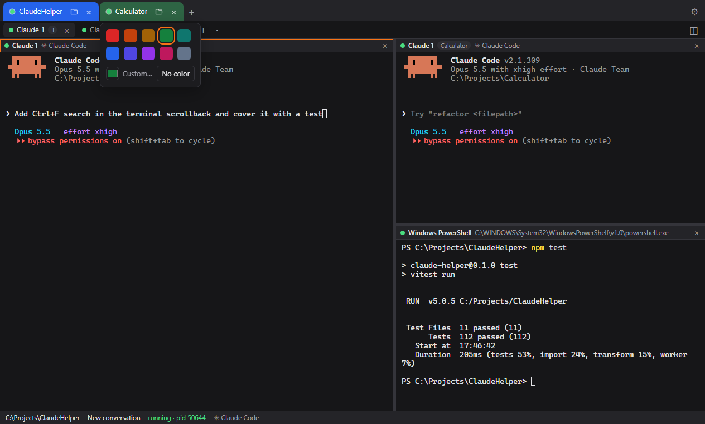

# ClaudeHelper

A desktop app for **Windows, macOS and Linux** that runs the real **Claude Code CLI** in tabs and split panes. Pick a folder and a Claude session starts there. Close the app, and next time everything comes back: folders, tabs, splits with their sizes, the window, and each tab's conversation.

**[Download the latest release](https://github.com/4rneorist/ClaudeHelper/releases/latest).** It has installers for Windows (`.exe`), macOS (`.dmg`, Apple Silicon) and Linux (`.AppImage` and `.deb`). You also need the Claude Code CLI, see [Install](#install).

### What's new in 1.0.1

- **See what each Claude is doing.** The status dot is green and pulsing while Claude works, yellow when it's done and waits for your next prompt, and red and pulsing when it needs your answer (a permission prompt, a question, a plan to approve). Folder tabs show what needs you most.
- **Never miss a session that needs you.** A sound for "finished" and another for "needs your answer", every time. For a session you aren't looking at, its tab is underlined, a toast says where it's from, and the bell at the top right keeps the list. With the window in the background or minimized, the taskbar button turns red or yellow and Windows shows a notification.
- **Get there fast.** Ctrl+Shift+J jumps to the next session that waits, the status bar counts them ("● 1 needs your answer · ● 2 finished"), and hovering a tab previews its last lines.
- **Less noise when you want it.** Mute a session or a folder, switch on Do not disturb, choose the sounds and their volume, and set how often a question that is still waiting reminds you.
- **Name and color your tabs.** ⚙ on a folder or session tab sets its title and color; drag tabs to reorder them.
- **Two folders side by side.** "Join sessions to" in a folder's settings shows two folders next to each other, each with its own tabs.
- **Git branch on each folder tab**, with `*` when there are uncommitted changes.

Details for each are under [Features](#features).


## Why ClaudeHelper

- **The real Claude Code, not a lookalike.** Every tab runs the `claude` CLI you already use, on the operating system's own terminal engine. Slash commands, permission prompts, Shift+Tab modes, Esc to interrupt, colors and resizing work as they do in Windows Terminal, iTerm2 or GNOME Terminal.
- **Windows, macOS and Linux.** One app with the same features on all three. It finds the shells each system has.
- **Remembers your workspace.** It saves the open folders, terminal tabs, split layouts **with their sizes**, the active tab and pane, and the window size and position. It saves as you go, so even a crash loses nothing. On the next start each Claude tab resumes its own conversation.
- **Many sessions side by side.** One tab per folder and several terminals in each, split right or down, or a 2×2 grid. Drag a tab onto the edge of a pane to dock it there. Join two folders to see them next to each other.
- **Find a folder or session at a glance.** Give folder and terminal tabs their own title and color. One click on the tab's folder icon opens it in File Explorer, Finder or your file manager.
- **Knows when Claude needs you.** Each tab shows whether Claude works, is done or waits for your answer, with a sound for each. Sessions you aren't looking at get a toast, an entry under the bell and a red or yellow taskbar button, and Ctrl+Shift+J takes you there.
- **Old conversations a click away.** The start screen lists the last conversations in each recent folder; click one to resume it.
- **A shell next to Claude.** PowerShell, Command Prompt, Git Bash and WSL on Windows; your login shell, bash, zsh and fish on macOS and Linux.

## Screenshots

**Start screen.** Recent folders, each with its last conversations.


**New terminal menu (▾).** A new, continued or resumed Claude conversation, or any shell installed on the machine.


**Settings.** Restoring on start, theme, font size and which `claude` to run. (Newer versions also have the notification, sound and reminder settings.)


**Tab colors.** Pick a color in a folder's or terminal's settings (⚙). (The screenshot shows the older color-only picker; ⚙ now also has the title, muting and, for folders, joining.)



## Install

ClaudeHelper runs the Claude Code CLI but doesn't include it. Install it and log in once before you start the app:

- **Windows (PowerShell):** `irm https://claude.ai/install.ps1 | iex`
- **macOS and Linux:** `curl -fsSL https://claude.ai/install.sh | bash`

Then run `claude` once in a terminal to log in. The app finds `claude` by itself. If yours lives somewhere unusual, set its path in **Settings**.

## Features

- **Folders as tabs:** each top-level tab is a folder.
  - Its folder icon opens the folder in File Explorer (Windows), Finder (macOS) or the file manager (Linux).
  - **⚙** (or a right-click on the tab) opens the folder's settings:
    - **Title:** shown instead of the folder name. **Reset** goes back to the name.
    - **Color:** one of ten presets, any custom color, or none. The open tab shows the full color, the others a softer one, and the title switches between black and white to stay readable.
    - **Join sessions to:** shows this folder next to another one, see **Folders side by side** below.
    - Changes apply as you make them; Esc undoes them. Title and color belong to the folder, so they come back whenever that folder is opened, and the start screen shows the title too.
  - ⚙ and the folder icon show on the open tab and on the one under the mouse.
  - Drag a folder tab to change the order.
- **Several terminals per folder:** they show as sub-tabs.
  - **+** opens a new Claude session.
  - **▾** offers New / Continue / Resume…, plus the shells installed on the machine:
    - **Windows:** PowerShell 7, Windows PowerShell, Command Prompt, Git Bash, WSL.
    - **macOS and Linux:** your login shell, bash, zsh, fish.
  - **⚙** on a sub-tab (or a right-click on it) sets its title, instead of Claude 1, Claude 2…, and its color. In a split, each pane's title bar has its own ⚙; the sub-tab shows its first pane's title and color. Both are saved with the layout.
  - Drag a sub-tab to change the order.
- **Split panes:**
  - **⊞** splits the current terminal right or down, or fills a 2×2 grid with Claude sessions.
  - Drag a divider to resize; double-click it to make both sides equal.
- **Drag to dock** (within a folder):
  - Drag a sub-tab onto the left, right, top or bottom edge of a pane to split with it.
  - Drag a pane's title bar onto the sub-tab row to make it its own tab again.
  - Hovering a dragged item over a sub-tab for half a second switches to it, so you can drop it into that tab's panes.
  - A terminal keeps running when it moves.
- **Folders side by side:**
  - In a folder's settings, pick another open folder under **Join sessions to**. The two show next to each other, that folder on the left and this one on the right, each with its own sub-tabs. Their tabs sit together, linked by ⇆, and move together when dragged.
  - Drag the divider between them to resize; double-click it to make both halves equal.
  - Clicking into either half makes that folder the active one, so shortcuts and the status bar follow it.
  - **None** shows them one at a time again, and closing either folder ends the pair. The pair and the divider position are saved with the layout.
- **Knows what Claude is doing:**
  - Claude Code puts a spinner in its window title while it works and ✳ when it stops; the app reads that, and when Claude stops it looks at the screen for a choice Claude waits for (a permission prompt, a question, a plan to approve).
  - The status dot on the pane, its tab and its folder tab shows it: **green and pulsing** while Claude works, **yellow** when it's idle and waits for your next prompt, **red and pulsing** when it needs your answer. A folder tab shows what needs you most. The status bar says "working", "idle" or "needs your answer".
  - Every time Claude finishes or asks, a sound plays, also for the session you are looking at: by default a soft falling chime when it finishes, a brighter rising one when it needs your answer. Settings lets you pick one of five sounds for each (▶ plays it) and the volume, or turn sounds off.
  - When Claude finishes or asks in a tab you aren't looking at (another tab, or the app in the background):
    - That tab and its folder tab get a yellow or red underline until you look at it.
    - A toast in the bottom right says where it's from ("my project › Claude 2") and what happened ("Claude needs your answer: Fix the login bug"); click it to go there.
    - The bell at the right of the top bar counts what you haven't seen (red if something asks) and lists everything from this run with its time; click an entry to go to that session. Looking at a session marks its entries read.
    - A terminal bell from Claude counts as asking.
  - If the app is in the background, its taskbar button flashes and an OS notification, with the app's icon, says the same; clicking it brings that tab up. Settings has switches for the OS notifications and for the sounds.
  - **What waits:** a session that asks for your answer, and one that finished while you were elsewhere and you haven't looked at yet.
    - The taskbar button shows it even with the window minimized (Windows): red while a session asks, yellow while one finished unseen, a moving green bar while any works, plus a red or yellow dot on the icon. On macOS the dock icon counts the sessions waiting.
    - The status bar shows "● 1 needs your answer · ● 2 finished" on the right; click a part to go to the next session of that kind.
    - **Ctrl+Shift+J** (Cmd+Shift+J on macOS) goes to the next waiting session, those that ask first.
  - **Reminder:** while a session keeps asking and you haven't looked, it calls again every 5 minutes (at most 3 times; Settings sets the interval or turns it off).
  - **Mute** a session or a whole folder in its ⚙ settings, for long jobs you don't need to hear about: it keeps its dot, underline and bell entry, but plays no sound, shows no toast or OS notification, and doesn't count as waiting. Muted tabs show a crossed-out bell.
  - **Do not disturb**, a switch at the top of the bell list: no sounds, toasts or OS notifications, while the list still fills. It switches off when the app restarts.
  - **Preview:** hold the mouse over a session tab to see what it's doing and its last lines (its question, when it asks).
- **Git branch:** each folder tab shows the folder's branch (the short commit when detached), with `*` for uncommitted changes, and so does the status bar. It is refreshed every 5 seconds and when the window gets focus, without taking git's index lock, so it never gets in the way of Claude's commits.
- **Picks up where you left off:**
  - The app saves the open folder tabs, terminal tabs, split layouts with their sizes, the active tab and pane, and the window size and position. Saving happens as you go: within a fraction of a second of opening a folder or tab, starting or resuming a session, closing, docking or resizing. A crash loses nothing. Everything reopens on the next start.
  - Each Claude tab resumes its own conversation, even after `/clear` or `/resume` inside claude switched it to another one. The app reads which conversation each running claude has open from Claude Code's session registry (`~/.claude/sessions/`), and watches it for changes.
  - Shell tabs reopen as fresh shells in the same folder.
  - **Restart** on an exited Claude tab also resumes its conversation.
  - Turn this off in Settings ("Reopen folders, tabs and splits from last time").
- **Recent sessions:**
  - Expand a recent folder (›) to see its last 5 Claude conversations, read from `~/.claude/projects` (or `$CLAUDE_CONFIG_DIR`).
  - Click one to resume it with `claude --resume <id>`.
  - If the folder is already open, the session opens as a sub-tab there.

The sessions run in a real terminal:
- **Renderer:** [xterm.js](https://xtermjs.org/) draws the terminal.
- **Engine:** [node-pty](https://github.com/microsoft/node-pty) runs `claude` on the OS's own terminal engine:
  - **Windows:** ConPTY, the console engine built into Windows 10/11. Settings has an experimental option for the newer `conpty.dll`/`OpenConsole.exe` engine from Windows Terminal that ships with node-pty. It is off by default because it occasionally crashed the app on exit in testing.
  - **macOS and Linux:** the standard Unix pseudo-terminal.

## Develop

You need:
- Node.js 22+ and npm. Only for building; the installed app doesn't need them.
- The Claude Code CLI, as in [Install](#install).
- Linux only: node-pty compiles at `npm install`, so you also need `python3`, `make` and `g++` (e.g. `sudo apt install build-essential python3`).

```bash
npm install
npm run dev          # app with hot reload
npm test             # unit tests (Vitest)
npm run test:e2e     # builds, then drives the real app with Playwright against a fake claude
npm run typecheck
npm run lint
```

## Build installers

```bash
npm run build:win           # installers/claude-helper-<version>-setup.exe (NSIS)
npm run build:mac           # installers/claude-helper-<version>.dmg
npm run build:linux         # installers/claude-helper-<version>.AppImage and a .deb
npm run build:linux:docker  # the Linux installers from Windows or macOS, built in Docker
npm run build:unpack        # unpacked app in installers/<platform>-unpacked, handy for testing
```

Everything lands in `installers/`, which git ignores.

node-pty is a native module, so each installer is built on its own system: the Windows one on Windows, the macOS one on a Mac. The Linux ones can also come from Windows or macOS: `build:linux:docker` copies the sources into a `node:22-bookworm` container, compiles node-pty there and copies the installers back. It needs Docker running.

To run the end-to-end tests against a packaged build:
`CLAUDE_HELPER_EXE=installers/win-unpacked/claude-helper.exe npx playwright test`.

To try a change in the running app next to your installed ClaudeHelper, give the dev app its own profile. Otherwise both share one, and the dev app reopens and resumes your open sessions a second time: `CLAUDE_HELPER_USER_DATA=<some empty folder> npm run dev`.

### Releases

Pushing a version tag builds all three installers on GitHub Actions (`.github/workflows/release.yml`) and attaches them to a draft release:

```bash
npm version 1.0.2            # sets the version in package.json, commits and tags v1.0.2
git push origin master v1.0.2
```

The tag has to match the version in `package.json`. Review the draft under **Releases** on GitHub and publish it. **Actions → Release → Run workflow** builds the installers without a release.

## Keyboard

| Action | Windows / Linux | macOS |
|---|---|---|
| Copy selection | Ctrl+C (only when text is selected), Ctrl+Shift+C, Ctrl+Insert | Cmd+C |
| Paste | Ctrl+V, Ctrl+Shift+V, Shift+Insert | Cmd+V |
| Paste image into the prompt | Ctrl+V (Linux) or Ctrl+V/Alt+V (Windows) with an image on the clipboard; claude reads it itself | Ctrl+V |
| Newline in the prompt | Shift+Enter (sent as Ctrl+J) | Shift+Enter |
| New Claude terminal in this folder | Ctrl+Shift+T | Cmd+T |
| New folder tab | Ctrl+Shift+N | Cmd+N |
| Close the focused terminal | Ctrl+Shift+W | Cmd+W |
| Next / previous terminal tab | Ctrl+Tab / Ctrl+Shift+Tab | same |
| Next / previous folder tab | Ctrl+PageDown / Ctrl+PageUp | same |
| Go to the next session that asks or finished unseen | Ctrl+Shift+J | Cmd+Shift+J |
| Font size bigger / smaller / reset | Ctrl+= / Ctrl+- / Ctrl+0, or Ctrl + mouse wheel | Cmd+= / Cmd+- / Cmd+0, or Cmd + wheel |

All other keys go straight to claude, including Ctrl+C with nothing selected, Esc, Shift+Tab, Ctrl+R, Ctrl+T and Ctrl+Shift+- (undo).

Other mouse actions:
- **Right-click in a terminal:** opens a Copy/Paste menu. On a folder tab, sub-tab or pane title bar it opens that tab's settings, like ⚙.
- **Links:** they open in your browser, which matters for the `/login` flow.
- **Dropping a file on a running session:** inserts its path.
- **Dropping a folder on the start screen:** opens a session there.

## How it is put together

```
Renderer (React + xterm.js)  ──window.api (preload, contextBridge)──▶  Main process
  TabBar (folders) → WorkspaceView (sub-tabs)                          ipc.ts (validates every call)
    → LayoutView (split tree of panes) → TerminalView                  sessionManager.ts (node-pty, output batching)
  terminal/TerminalSession.ts (one xterm per terminal,                 claudeResolver.ts (find claude, build env)
    survives being moved between panes and tabs)                       shells.ts (detect installed shells)
  terminal/claudeActivity.ts (working / idle / asking,                 claudeSessions.ts (past sessions per folder)
    from Claude's title and screen)                                    uiState.ts / windowState.ts (restore on start)
  attention.ts + waiting.ts + sounds.ts (sounds, toasts, bell list,    settingsStore.ts (JSON in userData)
    what waits, reminders) → Notifications, StatusBar                  attention.ts (OS notifications) / taskbar.ts
  gitPolling.ts (branch per folder)                                    gitInfo.ts (branch, uncommitted changes)
```

The store (`src/renderer/src/store.ts`) has three levels:
1. **Workspaces:** folders. Two can be joined (`joinedTo`) to show side by side.
2. **Sub-tabs:** each sub-tab holds a split layout.
3. **Terminals:** the layout's leaves. Terminals are stored flat by key, so moving one between layouts never restarts its process.

The split and dock rules are pure functions in `layout.ts`.

| Path | Contents |
|---|---|
| `src/shared/ipc.ts` | The one contract (channels and types) between main, preload and renderer |
| `src/main/` | Electron main process: window hardening, IPC handlers, PTY sessions, shells, past sessions, settings, OS notifications and the taskbar button, git branch |
| `src/preload/` | The minimal, typed `window.api` bridge |
| `src/renderer/src/` | React UI. Pure, tested functions: `layout.ts` (split/dock tree), `tabColors.ts` (tab colors and readable titles), `terminal/keybindings.ts`, `terminal/claudeActivity.ts` (what Claude is doing, from its title and screen) and `waiting.ts` (which sessions wait, in what order, reminders) |
| `tests/unit/` | Vitest tests for path resolution, session management, past-session parsing, shell detection, layouts, settings, tabs, joined folders, Claude's activity, what waits, notifications, git info, tab colors, validation and keybindings |
| `tests/e2e/` | Playwright tests that drive the built app. A fake `claude` reports how it was launched, echoes input, and can work, finish and ask like the real one |
| `scripts/` | `build-linux-docker.mjs`, which builds the Linux installers in Docker |
| `docs/screenshots/` | The screenshots in this README |

### Security

- **Renderer sandbox:** the renderer runs sandboxed with context isolation and no Node access. It has a strict CSP and cannot navigate away.
- **Main process checks:** the main process validates every IPC argument (session ids, terminal sizes, folders, URLs) and only accepts calls from its own window.
- **Links:** only `http(s)` links open externally.

### Environment passed to claude

The app passes on your full environment with these changes:
- **Terminal variables:** it sets `TERM=xterm-256color`, `COLORTERM=truecolor` and `TERM_PROGRAM=ClaudeHelper`.
- **Session markers:** it removes the variables a running Claude Code session injects into its children (`CLAUDECODE`, `CLAUDE_CODE_CHILD_SESSION`, …). If you start the app from inside a Claude session, the new sessions are still real top-level sessions.
- **macOS/Linux PATH:** the login shell's environment is loaded once at startup, so a `claude` installed through your shell profile is found even when the app starts from the Dock or a launcher.

## Roadmap

| Phase | Planned work |
|---|---|
| **2** | Per-launch `--model` and `--permission-mode`. Pinned folders. Search in scrollback. Claude's own status protocol (OSC 7501) on macOS and Linux, to tell a permission prompt from a finished turn (on Windows, ConPTY doesn't pass the terminal's reply back to claude) |
| **3** | An optional Docker sandbox per session. File tree and git diff panels. A browser for past conversations. Auto-update and code signing. A phone push (ntfy, Slack or Teams) when a session asks while you are away |

## License

[MIT](LICENSE) © 2026 Vasyl Kravinskyi
